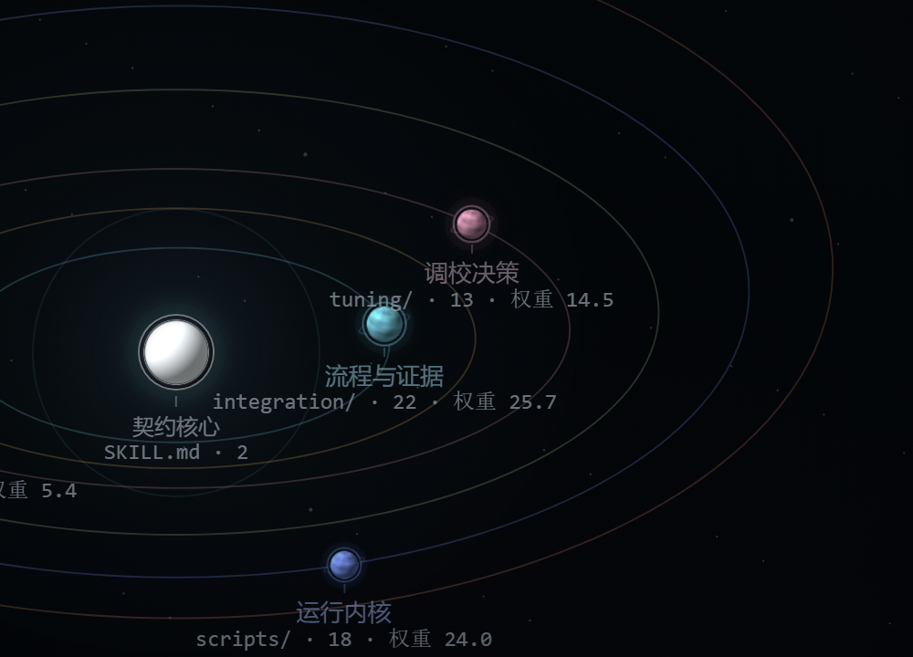

# PC Hardware Workbench

[中文](README.md) | [English](README.en.md)

PC Hardware Workbench is a Windows-focused, read-only hardware Skill for Codex and
DeepSeek Harness. It brings system inventory, troubleshooting, telemetry analysis,
guided tuning, and upgrade decisions into one workflow while leaving every
persistent hardware change to the user.

The current release line is a **2.6.0 test build**. Automated tests pass, but broad
real-device coverage and independent human acceptance are still in progress. The
project does not claim this test build is stable or fully validated.



The interactive project pages are currently Chinese-first:
[Project overview](https://feng23-feng.github.io/pc-hardware-workbench/skill-evolution/) ·
[Interactive lab](https://feng23-feng.github.io/pc-hardware-workbench/skill-evolution/interactive/) ·
[File orrery](https://feng23-feng.github.io/pc-hardware-workbench/skill-evolution/orrery/)

## Contents

- [What it does](#what-it-does)
- [Quick start](#quick-start)
- [Example prompts](#example-prompts)
- [Safety model](#safety-model)
- [Documentation](#documentation)
- [FAQ](#faq)
- [Development and testing](#development-and-testing)
- [Version and license](#version-and-license)

## What it does

- **Reads the current system configuration.** Inspect visible CPU, GPU, motherboard,
  memory, storage, display, and battery information without guessing missing models.
- **Prioritizes safe troubleshooting.** Address physical safety, boot and data risk,
  stability, functional faults, and performance in that order.
- **Analyzes real telemetry.** Read CSV files, HWiNFO exports, and structured sensor
  snapshots while preserving sample interval, missing values, source, and time range.
- **Requires evidence before tuning.** Device identity, baseline, recovery path, fixed
  workload, and stop conditions must be clear before a test candidate is produced.
- **Provides bounded GPU starting points.** When the device and evidence are complete,
  the Skill can propose one conservative, reversible, single-variable starting point.
- **Compares repair, retain, and upgrade decisions.** It does not reduce a decision to
  one benchmark score.
- **Uses additional evidence on demand.** Local RAG, an already-running local
  LibreHardwareMonitor instance, screenshots, and hardware cases that persist across
  sessions are optional inputs.
- **Remains read-only.** It does not modify BIOS, clocks, voltage, power limits, fans,
  memory timings, or firmware automatically.

## Quick start

### Install for Codex

The installer copies only the Skill tree. It does not run the hardware collector or
request administrator privileges.

```powershell
$installer = Join-Path $env:TEMP "install-pc-hardware-workbench.ps1"
curl.exe -fsSL "https://raw.githubusercontent.com/Feng23-feng/pc-hardware-workbench/main/tools/install-skill.ps1" -o $installer
powershell -NoProfile -ExecutionPolicy Bypass -File $installer
```

Restart Codex, then invoke:

```text
$pc-hardware-workbench
```

The default installation path is:

```text
%USERPROFILE%\.codex\skills\pc-hardware-workbench
```

To upgrade, rerun the installer with `-Force`:

```powershell
powershell -NoProfile -ExecutionPolicy Bypass -File $installer -Force
```

The previous version is moved outside the Codex Skill scan path:

```text
%USERPROFILE%\.codex\skill-backups\pc-hardware-workbench\
```

This prevents an old backup from being discovered as a second Skill with the same
name. The installer also migrates older `.backup-*` directories found inside the
Skill scan root.

### Install from a release ZIP

Open [GitHub Releases](https://github.com/Feng23-feng/pc-hardware-workbench/releases)
and choose one of these Codex packages:

- `pc-hardware-workbench-v<version>-installer.zip`: extract it and run
  `Install-PC-Hardware-Workbench.cmd`.
- `pc-hardware-workbench-v<version>-manual.zip`: extract it and place the included
  `pc-hardware-workbench/` folder at
  `%USERPROFILE%\.codex\skills\pc-hardware-workbench`.

Do not place the ZIP itself inside the Skill directory.

### Let an AI install it

```text
Install the PC Hardware Workbench Skill from:
https://github.com/Feng23-feng/pc-hardware-workbench

Copy only skill\pc-hardware-workbench to:
%USERPROFILE%\.codex\skills\pc-hardware-workbench

If the destination already exists, move it to a timestamped directory under:
%USERPROFILE%\.codex\skill-backups\pc-hardware-workbench\

Do not leave an older copy inside .codex\skills. Verify that SKILL.md, scripts, and
references are present. Do not run the hardware collector, request administrator
privileges, or modify BIOS, drivers, or system settings.
```

See [Installation and upgrade](docs/en/installation.md) for full instructions.

### DeepSeek Harness

The default Harness Skill path is:

```text
%USERPROFILE%\.dsh\skills\pc-hardware-workbench
```

Invoke it with:

```text
/pc-hardware-workbench
```

See the [DeepSeek Harness adapter](adapters/dsh/README.md) for adapter details.

### Portable Windows tools

The portable bundle can be used without a Skill host:

```powershell
cd portable
.\开始使用.cmd
```

Live collection is opt-in and requires explicit privacy-mode and collector flags.

## Example prompts

```text
Show me the current hardware configuration and identify what could not be read.
```

```text
The game occasionally stutters. Tell me what evidence is still missing before
recommending any overclocking values.
```

```text
Analyze this HWiNFO CSV for trends, missing data, and abnormal time windows.
```

```text
I want this GPU to run quieter, but I do not have a recovery point or a fixed test
workload yet.
```

The Skill routes the request to inventory, troubleshooting, telemetry, tuning, or
upgrade planning. When evidence is incomplete, it asks for the smallest useful next
step instead of bypassing safety gates.

## Safety model

- No automatic BIOS/UEFI, clock, voltage, power-limit, fan, memory-timing, or firmware
  changes.
- No automatic elevation, driver installation, or monitoring-software startup.
- No bypass of permissions, anti-cheat, vendor locks, or other safety controls.
- Stop when there is a burning smell, spark, liquid, melted connector, swollen battery,
  or visible damage.
- No tuning experiment without a recovery path and stop conditions.
- The Skill reads LibreHardwareMonitor only when the user has already started it and
  explicitly allows access to the local loopback endpoint.

Hardware parameters are test starting points, not guarantees. Safety takes priority.

Read [Privacy and safety boundaries](docs/en/privacy-and-safety.md) for the full policy.

## Documentation

- [English installation and upgrade](docs/en/installation.md)
- [English privacy and safety](docs/en/privacy-and-safety.md)
- [Chinese installation and upgrade](docs/installation.md)
- [Chinese usage guide](docs/usage.md)
- [Chinese architecture](docs/architecture.md)
- [Chinese troubleshooting](docs/troubleshooting.md)
- [Chinese testing and release checks](docs/testing.md)
- [Changelog](CHANGELOG.md)
- [GitHub Releases](https://github.com/Feng23-feng/pc-hardware-workbench/releases)
- [Contributing](CONTRIBUTING.md)
- [Security policy](SECURITY.md)

Advanced architecture, behavior-test, and contributor documentation are currently
available in Chinese.

## FAQ

- **Codex does not show the Skill.** Confirm that `SKILL.md` exists in the installed
  directory, then restart Codex.
- **Collection returns access denied.** Retry in a normal, non-elevated PowerShell
  session. The Agent sandbox may restrict CIM, storage, or display queries.
- **LibreHardwareMonitor returns no data.** LHM must already be running, its web server
  must be bound to loopback, and the user must explicitly allow access.
- **A CSV is rejected.** Do not use UNC paths, mapped network drives, cloud placeholder
  files, symbolic links, directory junctions, or other reparse points.
- **GPU tuning is blocked.** Provide the exact GPU, current control values, baseline,
  fixed workload, recovery path, and stop conditions.

## Development and testing

The repository contains the Skill, a DeepSeek Harness adapter, portable Windows tools,
automated tests, release packaging, and the project website.

Run the structural validator:

```powershell
powershell -NoProfile -ExecutionPolicy Bypass `
  -File .\tools\validate-skill.ps1
```

See [Testing and release checks](docs/testing.md) for the full suite and package
verification workflow.

## Version and license

Use [GitHub Releases](https://github.com/Feng23-feng/pc-hardware-workbench/releases)
and [CHANGELOG.md](CHANGELOG.md) as the source of version status. The current release
line is a `2.6.0` test build.

Source code is available under the [MIT License](LICENSE).

Copyright (c) 2026 Feng23-feng.

Third-party software, installers, images, and vendor materials remain subject to their
own licenses and may not be redistributed without separate permission.
