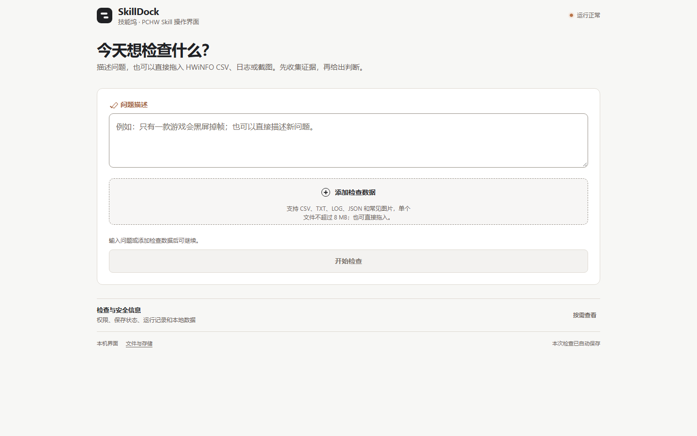
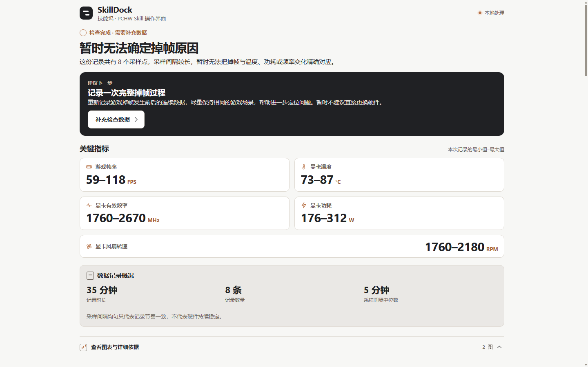
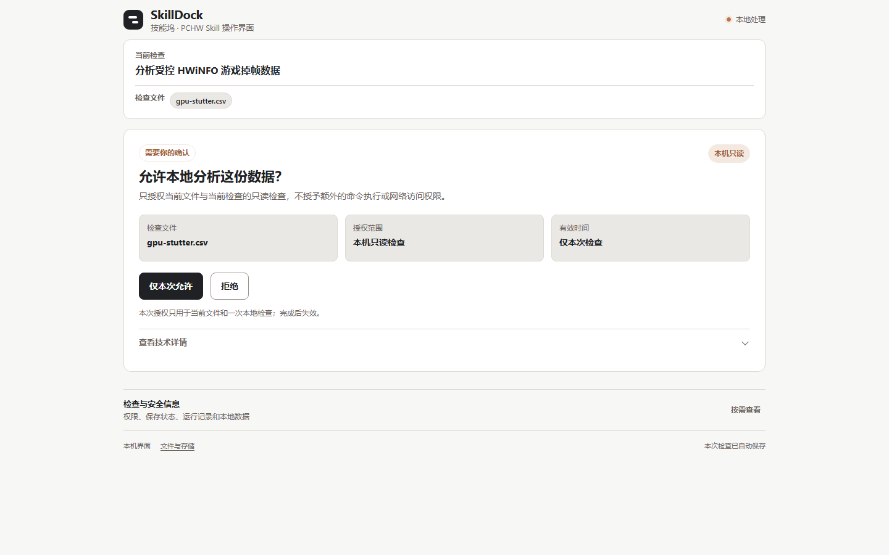

# PC Hardware Workbench

[中文](README.md) | [English](README.en.md)

**A Windows hardware diagnostic and safe-tuning Agent Skill.** Use it from
Codex, DeepSeek Harness, or another compatible Agent to read local hardware
inventory, analyze HWiNFO and PresentMon CSV files, logs, and screenshots, and
turn the evidence into troubleshooting, tuning, or upgrade guidance. Every
persistent hardware change remains manual.

The current PCHW public pre-release is **2.9.3-test.2**. There is no stable
release.

[Download PCHW Skill](https://github.com/Feng23-feng/pc-hardware-workbench/releases/download/v2.9.3-test.2/pc-hardware-workbench-v2.9.3-test.2-installer.zip) ·
[Download SkillDock panel](https://github.com/Feng23-feng/pc-hardware-workbench/releases/download/v0.1.0-rc.7/SkillDock-PCHW-0.1.0-rc.7-win-x64-user.zip) ·
[Download Portable](https://github.com/Feng23-feng/pc-hardware-workbench/releases/download/v2.9.3-test.2/pc-hardware-portable-v2.9.3-test.2.zip) ·
[Project site](https://feng23-feng.github.io/pc-hardware-workbench/skill-evolution/)

  

## What it helps with

- **Inspect the current system.** Read visible CPU, GPU, motherboard, memory,
  storage, display, and battery information, and state which fields could not be
  read without guessing missing models.
- **Investigate stutter, frame drops, and thermal issues.** Read HWiNFO and
  PresentMon CSV files, sensor snapshots, and logs while preserving time range,
  sample interval, missing values, and source for traceable charts and evidence.
- **Reduce blind tuning risk.** CPU/GPU tuning first checks device identity,
  baseline, fixed workload, recovery path, and stop conditions. Incomplete
  evidence produces the smallest useful next step, not values to apply directly.
- **Choose between keep, repair, and upgrade.** Compare the device, workload,
  budget, and available evidence instead of reducing the decision to one score.

PCHW is an Agent Skill, not a separate chatbot. The Agent handles conversation
and reasoning; local tools provide read-only collection, deterministic analysis,
and evidence checks. SkillDock is the optional graphical layer.

## Choose an installation

| Your situation | Choose | What you get |
| --- | --- | --- |
| Chat, collect, and analyze from Codex or another compatible Agent | **PCHW Skill** | Full Skill, scripts, evidence rules, and local analysis; no panel |
| You want the Graphite Copper 2.0 graphical workspace | **SkillDock + PCHW** | Local panel, attachments, charts, and results in the current Codex conversation; the rc.7 user package bundles a PCHW release subset based on `2.9.3-test.1` |
| You do not use an Agent, or want no installation | **PCHW Portable** | Standalone Windows menu, collection, CSV/log analysis, and evidence tools |

### 1. PCHW Skill

[Download the PCHW Skill installer](https://github.com/Feng23-feng/pc-hardware-workbench/releases/download/v2.9.3-test.2/pc-hardware-workbench-v2.9.3-test.2-installer.zip)

1. Verify and extract `pc-hardware-workbench-v2.9.3-test.2-installer.zip`.
2. Double-click `Install-PC-Hardware-Workbench.cmd`.
3. Restart Codex or start a new conversation.
4. Invoke `$pc-hardware-workbench`.

This package does not include SkillDock, Node.js, or the DSH-specific adapter.
The default Codex path is
`%USERPROFILE%\.codex\skills\pc-hardware-workbench`.

### 2. SkillDock panel

[Download the SkillDock rc.7 user bundle](https://github.com/Feng23-feng/pc-hardware-workbench/releases/download/v0.1.0-rc.7/SkillDock-PCHW-0.1.0-rc.7-win-x64-user.zip)

The current public panel test bundle is **SkillDock `0.1.0-rc.7`**. Its user
package bundles a PCHW `2.9.3` release subset based on `2.9.3-test.1`; it does
not contain the newer `2.9.3-test.2`. It is contract-compatible with
`2.9.3-test.2` through `pchw-source-hosted` contract `1.0`, UI schema `1.2`,
event schema `1.0`, and required capabilities, but the cross-package combination
has not completed integrated human signoff as one release bundle.

1. With Codex Desktop already installed, download the `win-x64-user.zip` above.
2. Verify it, extract it, and double-click `Install.cmd`.
3. Wait for installation, then open the current Codex user conversation.
4. Describe the hardware problem; after explicit consent, the Skill opens the
   panel for that current task.

SkillDock is not another Agent and does not replace Codex. The panel is promised
only for the current Codex user conversation. DSH and other hosts continue to use
the non-panel PCHW Skill. The rc.7 user bundle backs up and replaces an existing
PCHW Skill. To keep `2.9.3-test.2`, install the standalone `test.2` Skill first
and use Runtime-only from Advanced options instead of running the integrated user
bundle.

### 3. PCHW Portable

[Download PCHW Portable](https://github.com/Feng23-feng/pc-hardware-workbench/releases/download/v2.9.3-test.2/pc-hardware-portable-v2.9.3-test.2.zip)

1. Verify and extract `pc-hardware-portable-v2.9.3-test.2.zip`.
2. Double-click `开始使用.cmd`.
3. Choose inventory, troubleshooting, telemetry, PresentMon, or guided manual
   tuning from the menu.

Portable needs no Codex, DSH, API key, installer, or administrator rights. It
does not provide Agent conversation or the SkillDock panel.

## A redacted GPU frame-drop case

This example uses a redacted GPU frame-drop record. The page does not produce a
“hardware health score.” It starts with the limitation: 35 minutes contain only
8 samples at a median interval of 5 minutes, so the record cannot precisely tie
the drops to changes in temperature, power, or clock frequency. The record shows
`59–118 FPS`, GPU temperature `73–87 °C`, effective clock `1760–2670 MHz`, and
power `176–312 W`. Those values show that changes occurred, but they do not
independently prove the cause of the frame drops. The next step is a continuous
recording around the failure, not an immediate hardware replacement.
This is the core PCHW rule: **state what the evidence can and cannot prove before
recommending the next action.**

  <picture>
    <source media="(max-width: 700px)" srcset="docs/skill-evolution/assets/pchw-result-mobile.png">
    
  </picture>

## Permission and safety boundaries

  

- No automatic changes to BIOS/UEFI, clocks, voltage, power limits, fans, memory
  timings, or firmware.
- No automatic elevation, driver installation, or monitoring-software startup,
  and no bypass of permissions, anti-cheat, vendor locks, or safety controls.
- Local analysis requires explicit consent. “Allow this time only” covers only
  the current file and current check.
- CSV analysis binds artifacts to source hashes; cross-file reuse and integrity
  mismatches fail closed.
- Stop when there is a burning smell, spark, liquid, melted connector, swollen
  battery, or visible damage.
- GPU tuning requires current control values, a baseline, fixed workload,
  recovery path, and stop conditions.

Read [Privacy and safety boundaries](docs/en/privacy-and-safety.md) for details.

## Current release status

- PCHW: [`2.9.3-test.2`](https://github.com/Feng23-feng/pc-hardware-workbench/releases/tag/v2.9.3-test.2),
  a public pre-release with no stable release.
- SkillDock: [`v0.1.0-rc.7`](https://github.com/Feng23-feng/pc-hardware-workbench/releases/tag/v0.1.0-rc.7).
  Its user bundle contains a PCHW `2.9.3` release subset based on
  `2.9.3-test.1`; no newer public panel build is referenced.
- SkillDock rc.7 is contract-compatible with PCHW `2.9.3-test.2`, but the
  Skill-only plus Runtime-only cross-package combination remains PENDING and is
  not equal to integrated human signoff.
- The two channels use independent release lines, and incompatible panel versions
  fail closed.
- `BroadDistributionApproved: false`.
- `SKIP`: Live LHM Web/WMI reads when no authorized running LibreHardwareMonitor
  environment is available.
- `PENDING`: real Codex Thread permission allow/deny and recovery, human
  interaction, clean-Windows install/upgrade/repair/uninstall, multi-platform
  acceptance, and final packaged-byte Edge acceptance.

Automated tests do not rewrite these items to `PASS`, and they do not establish a
stable release.

## Advanced options

The following paths preserve existing capabilities but are not the first choice
for most users.

<strong>DSH, manual install, Runtime-only, support matrix, and historical builds</strong>

### DeepSeek Harness

[Download the DSH adapter](https://github.com/Feng23-feng/pc-hardware-workbench/releases/download/v2.9.3-test.2/pc-hardware-workbench-deepseek-harness-v2.9.3-test.2.zip)

The package contains PCHW 2.9.3 Skill and DSH adapter files. DSH supports
configuration, troubleshooting, collection, and CSV analysis, but not the
SkillDock panel.

### Manual install

[Download the manual package](https://github.com/Feng23-feng/pc-hardware-workbench/releases/download/v2.9.3-test.2/pc-hardware-workbench-v2.9.3-test.2-manual.zip)

Use this when you need to inspect the package contents or install without the
bundled installer. Do not leave multiple PCHW versions containing `SKILL.md` in
one host scan directory.

### SkillDock Runtime-only

[Download SkillDock Runtime-only](https://github.com/Feng23-feng/pc-hardware-workbench/releases/download/v0.1.0-rc.7/SkillDock-Runtime-0.1.0-rc.7-win-x64.zip)

Use this only when a compatible PCHW Skill is already installed and only the
SkillDock application and Node.js are missing. rc.7 preserves exact PCHW `2.8.0`
as a legacy bridge. Later versions must declare a compatible
`surface_contracts["pchw-source-hosted"]`, satisfy the minimum version and
required capabilities, and use the expected UI/event schemas; mismatches fail
closed. This is the advanced path for keeping PCHW `2.9.3-test.2` and adding only
the panel runtime, but that cross-package combination is still PENDING.

### Support matrix

| Host | PCHW chat, collection, CSV | SkillDock panel |
| --- | --- | --- |
| Current Codex user conversation | Supported | Supported |
| DeepSeek Harness | Supported | Not provided |
| Other Agent hosts | Use according to host file access | Not promised |

`v0.1.0-rc.5 + PCHW 2.9.0` and `v0.1.0-rc.4 + PCHW 2.8.0` remain historical
panel test builds only. See [Installation and upgrade](docs/en/installation.md)
for setup, upgrade, and troubleshooting.

## Technical capabilities

<strong>Deterministic evidence, memory-clock bases, hardware cases, RAG, and the local evidence CLI</strong>

- `pcwb.ps1` exposes read-only inventory, telemetry, PresentMon, evidence-package,
  claim-verification, and Doctor routes through a fixed JSON envelope, structured
  status/exit codes, and SHA-256-linked inputs and artifacts.
- Raw HWiNFO memory-clock values remain the default. The explicit deep view
  derives an Afterburner-equivalent value only when GPU, raw tool, display tool,
  and versions match a controlled profile; provisional profiles fail closed.
- Telemetry analysis preserves sampled span, missing values, source, time
  window, and selected-row categorical counts. Plain text analysis returns a
  summary by default and creates chart artifacts only when requested.
- Claim verification distinguishes measured current values, user confirmation,
  historical records, estimates, conflicts, and unverifiable values.
- Multi-turn, multi-evidence, or parameter-change work can keep a private local
  case and resume a new conversation from a compact packet without treating old
  values as current measurements.
- A local RAG evidence cache, host-supported web lookup, an already-running local
  LibreHardwareMonitor instance, screenshots, and cross-session hardware cases are
  optional inputs.

## Feedback and documentation

- [Report a problem or share feedback](https://github.com/Feng23-feng/pc-hardware-workbench/issues/new/choose)
- [Installation and upgrade](docs/en/installation.md)
- [Privacy and safety](docs/en/privacy-and-safety.md)
- [Chinese usage guide](docs/usage.md)
- [Chinese troubleshooting](docs/troubleshooting.md)
- [Chinese architecture](docs/architecture.md)
- [Changelog](CHANGELOG.md)
- [GitHub Releases](https://github.com/Feng23-feng/pc-hardware-workbench/releases)
- [Project site](https://feng23-feng.github.io/pc-hardware-workbench/skill-evolution/) ·
  [Scenario Walkthrough](https://feng23-feng.github.io/pc-hardware-workbench/skill-evolution/interactive/) ·
  [File orrery](https://feng23-feng.github.io/pc-hardware-workbench/skill-evolution/orrery/)

Before posting, remove usernames, serial numbers, absolute paths, API keys, and
other personal data. For hardware logs, prefer a redacted CSV with the device,
time range, and sample interval still visible.

## Version and license

Use [GitHub Releases](https://github.com/Feng23-feng/pc-hardware-workbench/releases)
and [CHANGELOG.md](CHANGELOG.md) as the source of version status. The `main`
branch may be ahead of the latest public release.

Source code is available under the [MIT License](LICENSE).
Copyright (c) 2026 Feng23-feng.

Third-party software, installers, images, and vendor materials remain subject to
their own licenses and may not be redistributed without separate permission.
