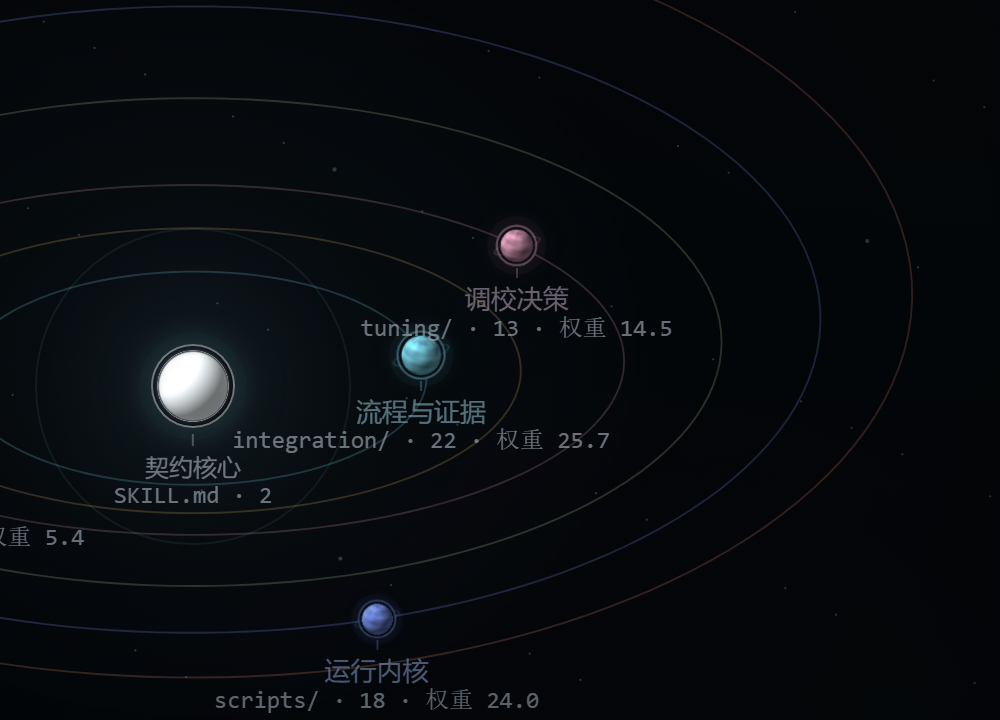

# PC Hardware Workbench

[中文](README.md) | [English](README.en.md)

一个面向 Codex 和 DeepSeek Harness 的 Windows 只读硬件工作台。它把配置读取、
故障排查、遥测分析、手动调校和升级判断收敛到一个 Skill，同时把每一次硬件变更
留给用户亲手完成。

当前版本为 **2.6.0 测试版**。非实机自动测试已通过，真实设备覆盖和独立人工签署
仍在继续；项目不会把测试版包装成已经完成广泛验证的稳定版。



[项目说明](https://feng23-feng.github.io/pc-hardware-workbench/skill-evolution/) ·
[交互实验室](https://feng23-feng.github.io/pc-hardware-workbench/skill-evolution/interactive/) ·
[文件星球](https://feng23-feng.github.io/pc-hardware-workbench/skill-evolution/orrery/)

## 目录

- [功能](#功能)
- [快速开始](#快速开始)
- [使用示例](#使用示例)
- [安全边界](#安全边界)
- [文档](#文档)
- [常见问题](#常见问题)
- [开发与测试](#开发与测试)
- [版本与许可](#版本与许可)

## 功能

- **读取电脑配置。** 只读查看处理器、显卡、主板、内存、存储、显示器和电池等
  当前可见信息，不猜测缺失型号。
- **排障先保安全。** 按物理安全、启动与数据、稳定性、功能故障和性能排序，避免
  用超频或换件掩盖尚未解释的问题。
- **分析真实遥测。** 读取 CSV、HWiNFO 导出和结构化传感器快照，保留采样间隔、
  缺失值、来源和时间窗口，并可生成图表。
- **调参必须有证据。** 参数请求先通过设备、基线、恢复路径、固定负载和停止条件
  门禁；信息不足时不生成可直接套用的数字。
- **GPU 起始候选。** 仅对可识别且条件齐全的显卡给出一个有限、可回退的单变量
  起点；未知、专业卡、核显、虚拟适配器和多适配器目标会被阻断。
- **升级判断。** 比较继续保留、维护和购买新硬件的收益，不用一个跑分替代场景、
  预算和证据。
- **按需接入更多证据。** 支持本地 RAG 证据缓存、宿主可用时的联网查证、已经运行
  的本机 LibreHardwareMonitor、视觉截图说明和跨轮硬件案卷。
- **始终只读。** 不自动修改 BIOS、频率、电压、功耗、风扇、内存时序或固件。

## 快速开始

### Codex 一键安装

安装脚本只复制 Skill 文件，不运行硬件采集器，也不请求管理员权限。

1. 打开普通 PowerShell。
2. 下载安装脚本。
3. 运行安装脚本。
4. 重启 Codex，然后输入 `$pc-hardware-workbench`。

```powershell
$installer = Join-Path $env:TEMP "install-pc-hardware-workbench.ps1"
curl.exe -fsSL "https://raw.githubusercontent.com/Feng23-feng/pc-hardware-workbench/main/tools/install-skill.ps1" -o $installer
powershell -NoProfile -ExecutionPolicy Bypass -File $installer
```

默认安装位置：

```text
%USERPROFILE%\.codex\skills\pc-hardware-workbench
```

更新时重新运行安装器并加 `-Force`。旧版本会先移动到 Skill 扫描目录之外：

```powershell
powershell -NoProfile -ExecutionPolicy Bypass -File $installer -Force
```

备份位于：

```text
%USERPROFILE%\.codex\skill-backups\pc-hardware-workbench\
```

也可以从 [GitHub Releases](https://github.com/Feng23-feng/pc-hardware-workbench/releases)
下载 Codex 版 `installer.zip` 或 `manual.zip`。`installer.zip` 解压后双击
`Install-PC-Hardware-Workbench.cmd`；`manual.zip` 解压后直接得到可手动放置的
`pc-hardware-workbench/`。如果已有安装，自动安装器会先创建带时间戳、但不参与
Skill 扫描的备份。

`manual.zip` 不会自动备份；手动升级前，应先把现有目录移动到
`%USERPROFILE%\.codex\skill-backups\pc-hardware-workbench\`。

`installer.zip` 还包含 `README.en.md` 和英文安装、隐私安全文档。

### 让 AI 安装

可以直接把下面的提示词交给能执行本地命令的 AI：

```text
请安装 PC Hardware Workbench Skill：
https://github.com/Feng23-feng/pc-hardware-workbench

只复制仓库中的 skill\pc-hardware-workbench 到：
%USERPROFILE%\.codex\skills\pc-hardware-workbench

如果目标已存在，先移动到
%USERPROFILE%\.codex\skill-backups\pc-hardware-workbench\ 下带时间戳的备份。
不要把旧版本继续留在 .codex\skills 里。安装后确认 SKILL.md、scripts
和 references 都存在。不要运行硬件采集器，不要请求管理员权限，
不要修改 BIOS、驱动或系统设置。
```

完整版见 [AI 安装提示词](docs/AI-INSTALL.md)。

### DeepSeek Harness

Skill 默认放到：

```text
%USERPROFILE%\.dsh\skills\pc-hardware-workbench
```

调用：

```text
/pc-hardware-workbench
```

Harness 适配和详细步骤见
[安装与升级](docs/installation.md#deepseek-harness)与
[DSH adapter](adapters/dsh/README.md)。

### 独立 Windows 工具

不安装 Codex Skill，也可以直接运行 Portable 版本：

```powershell
cd portable
.\开始使用.cmd
```

详见 [安装与升级](docs/installation.md#portable-windows-工具)。

## 使用示例

```text
帮我看看这台电脑现在的配置，有哪些信息读不到？
```

```text
游戏偶尔卡顿。先判断还需要哪些证据，不要直接给我超频参数。
```

```text
这是我导出的一天 HWiNFO CSV，帮我检查趋势、缺失值和异常时间窗。
```

```text
我想让这张显卡更安静，但还没有恢复点和固定测试场景。
```

Skill 会根据问题进入配置、排障、遥测、调参或升级路线。信息不足时，只返回最小
补证动作，不会跳过安全门禁。

## 安全边界

- 不自动修改 BIOS/UEFI、频率、电压、功耗墙、风扇、内存时序或固件；
- 不自动提权、安装驱动或启动监控软件；
- 不绕过权限、反作弊、厂商锁或安全限制；
- 出现焦味、火花、液体、熔化接头、鼓包电池或可见破损时，先停止；
- 没有恢复路径和中止信号时，不生成硬件参数实验；
- LibreHardwareMonitor 只在已经运行且用户明确允许时，通过本机 loopback Web
  或只读 WMI 后备读取数据。

参数仅供参考，请以安全为第一要务。

完整说明见 [隐私与安全边界](docs/privacy-and-safety.md)。

## 文档

- [安装与升级](docs/installation.md)
- [使用方式](docs/usage.md)
- [技术架构](docs/architecture.md)
- [常见问题](docs/troubleshooting.md)
- [测试与发布检查](docs/testing.md)
- [隐私与安全边界](docs/privacy-and-safety.md)
- [English README](README.en.md)
- [English installation](docs/en/installation.md)
- [English privacy and safety](docs/en/privacy-and-safety.md)
- [变更记录](CHANGELOG.md)
- [GitHub Releases](https://github.com/Feng23-feng/pc-hardware-workbench/releases)
- [贡献指南](CONTRIBUTING.md)
- [安全报告](SECURITY.md)

## 常见问题

- **Codex 里看不到 Skill**：确认安装目录中的 `SKILL.md` 存在，然后重启 Codex。
- **采集出现权限拒绝**：先在普通、非提权 PowerShell 中重试；Agent 沙箱可能限制
  CIM、存储或显示器信息读取。
- **LHM 没有数据**：LHM 必须已经由用户启动，Web Server 只绑定 loopback，并且
  用户明确允许读取。
- **CSV 被拒绝**：不要使用 UNC 路径、映射网络盘、云占位文件、符号链接、目录
  联接或重解析点。
- **GPU 调参被阻断**：先补齐型号、当前控制值、基线、固定负载、恢复路径和停止
  条件；不要通过改写提问绕过门禁。

更多问题见 [常见问题](docs/troubleshooting.md)。

## 开发与测试

仓库包含 Skill、DeepSeek Harness 适配、Portable 工具、自动测试、发布打包和
项目说明站。

以下命令需要在源码 checkout 中运行；仅安装或使用发布包时不需要执行。

快速结构验证：

```powershell
powershell -NoProfile -ExecutionPolicy Bypass `
  -File .\tools\validate-skill.ps1
```

完整测试、同步检查、发布打包和验证环境说明见
[测试与发布检查](docs/testing.md)。

## 版本与许可

版本状态以 [GitHub Releases](https://github.com/Feng23-feng/pc-hardware-workbench/releases)
和 [CHANGELOG.md](CHANGELOG.md) 为准。当前工作台版本为 `2.6.0` 测试版。

源码使用 [MIT License](LICENSE)。

Copyright (c) 2026 Feng23-feng.

第三方软件、安装器、图片和厂商资料继续遵循各自许可证；未经单独许可不得重新
分发。
