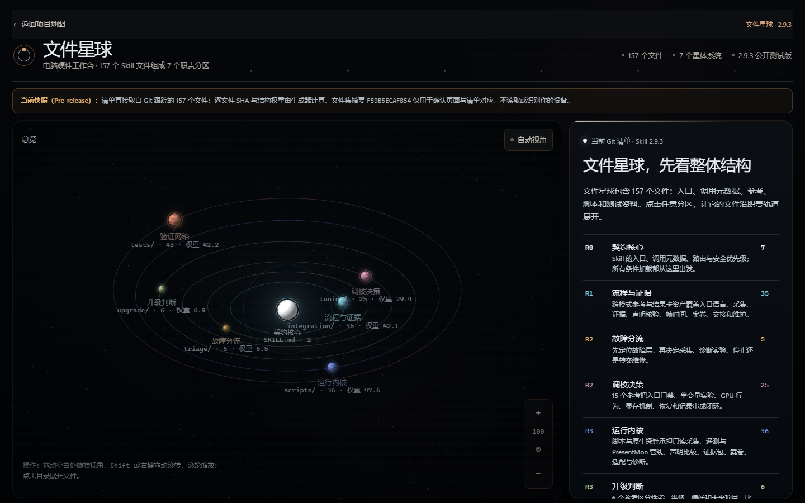

# PC Hardware Workbench

[中文](README.md) | [English](README.en.md)

一个面向 Codex 和 DeepSeek Harness 的 Windows 只读硬件工作台。它把配置读取、
故障排查、遥测分析、手动调校和升级判断收敛到一个 Skill，同时把每一次硬件变更
留给用户亲手完成。

当前版本为 **2.8.0 测试版**，尚未正式发布。完整自动测试和定向人工审阅已通过；
真实设备覆盖、干净 Windows 安装/卸载和其余交互场景签署仍在继续。项目不会把
测试版包装成稳定版。



[项目说明](https://feng23-feng.github.io/pc-hardware-workbench/skill-evolution/) ·
[交互实验室](https://feng23-feng.github.io/pc-hardware-workbench/skill-evolution/interactive/) ·
[文件星球](https://feng23-feng.github.io/pc-hardware-workbench/skill-evolution/orrery/)

## 目录

- [功能](#功能)
- [快速开始](#快速开始)
- [打开 SkillDock 操作面板](#打开-skilldock-操作面板)
- [使用示例](#使用示例)
- [安全边界](#安全边界)
- [支持矩阵](#支持矩阵)
- [已知限制](#已知限制)
- [文档](#文档)
- [常见问题](#常见问题)
- [版本与许可](#版本与许可)

## 功能

- **读取电脑配置。** 只读查看处理器、显卡、主板、内存、存储、显示器和电池等
  当前可见信息，不猜测缺失型号。
- **排障先保安全。** 按物理安全、启动与数据、稳定性、功能故障和性能排序，避免
  用超频或换件掩盖尚未解释的问题。
- **分析真实遥测。** 读取 CSV、HWiNFO 导出和结构化传感器快照，保留采样间隔、
  缺失值、来源和时间窗口；有可用指标时生成 SVG 图表。
- **展示时间计划。** 多阶段调校、预热、复查、重启和回归时间线可生成甘特图；
  单步建议或时长不明时不会硬画。`done` 表示执行结束但未判定，`pass/fail` 仍表示测试结论。
- **核验用户声明。** 区分当前实测、用户刚确认、历史记录、估算和冲突，避免把旧值
  自动升级成当前值。
- **分析帧时间。** 只读导入 PresentMon CSV，统计平均 FPS、P95/P99、1%/0.1% low、
  尖峰帧与尖峰簇，不自动启动工具或接入游戏进程。
- **主动保存排查现场。** 多轮、多证据或包含参数变更的调试会维护一个私人本地案卷，
  记录证据、基线、实验、通过/中止条件、恢复方式和下一步；新对话可用紧凑恢复摘要
  接续，不需要重放全部聊天。
- **调参必须有证据。** 参数请求先通过设备、基线、恢复路径、固定负载和停止条件
  门禁；信息不足时不生成可直接套用的数字。
- **GPU 起始候选。** 仅对可识别且条件齐全的显卡给出一个有限、可回退的单变量
  起点；未知、专业卡、核显、虚拟适配器和多适配器目标会被阻断。
- **升级判断。** 比较继续保留、维护和购买新硬件的收益，不用一个跑分替代场景、
  预算和证据。
- **按需接入更多证据。** 支持本地 RAG 证据缓存、宿主可用时的联网查证、已经运行
  的本机 LibreHardwareMonitor、视觉截图说明和跨轮硬件案卷。
- **始终只读。** 不自动修改 BIOS、频率、电压、功耗、风扇、内存时序或固件。

## 三种使用方式

按使用场景选择对应的包；不要把同一个 Skill 的多个副本放进同一个宿主扫描目录。

| 包 | 适合谁 | 包含 | 操作面板 |
| --- | --- | --- | --- |
| 简易便携包 | 不想安装 Skill 或宿主 | 本地 PowerShell 硬件采集、CSV、图表和报告 | 无 SkillDock，使用本地菜单 |
| DSH core-only 包 | 使用 DeepSeek Harness | PCHW Skill 与 DSH 适配 | 无 SkillDock 面板 |
| Codex + SkillDock 包 | 使用 Codex Desktop，并需要当前对话操作面板 | PCHW Skill、SkillDock Runtime、单一安装入口 | 仅 Codex 当前对话 |

当前候选资产名称：

```text
pc-hardware-portable-v2.8.0.zip
pc-hardware-workbench-deepseek-harness-v2.8.0.zip
SkillDock-PCHW-0.1.0-rc.1-win-x64-user.zip
```

2.8.0 尚未正式发布，以上是当前候选命名；以 Releases 中实际存在的文件和 SHA-256
sidecar 为准。不要根据旧版本资产名混装。

### Codex + SkillDock

1. 下载并校验 Codex 集成包及 `.sha256`。
2. 解压后双击 `Install.cmd`。
3. 已有旧版 PCHW Skill 时，安装器会先备份，再执行安全升级；不需要先删除旧 Skill。
4. 安装完成后打开 Codex 当前对话。
5. 描述硬件问题并明确同意打开图形化分析。

用户不需要寻找 runner、端口、token 或环境变量，也不需要手动启动
`SkillDock.exe`。安装器会从同一个候选包中安装 PCHW Skill 与 SkillDock Runtime。

### DSH core-only

DSH 包只提供 PCHW Skill 和 Harness 适配，不包含 SkillDock 面板。将包内 Skill
安装到 `%USERPROFILE%\.dsh\skills\pc-hardware-workbench`，然后调用：

```text
/pc-hardware-workbench
```

详细步骤见 [安装与升级](docs/installation.md#deepseek-harness)。

### 简易便携包

不需要 Codex、DSH 或 SkillDock。解压便携包后运行：

```powershell
cd portable
.\开始使用.cmd
```

便携包只在本机执行用户确认的只读采集，并在需要时生成图表或报告。

## 打开 SkillDock 操作面板

安装 PCHW Skill 和 SkillDock Runtime 后，不需要寻找 runner 或设置环境变量。
在 Codex 当前对话中直接描述问题和附件，例如：

```text
我玩游戏二十分钟后开始掉帧，这是 HWiNFO CSV。可以打开图形化分析吗？
```

同意打开后，Skill 会把当前问题、Task 和支持的附件带入本地面板。首次分析时，
页面会请求一次明确的“仅本次允许”；允许后可以查看真实 SVG、具体判断、支持与冲突
证据、不确定性，以及两到三条低风险采集建议。结果会自动写回页面，不需要按 F5。
复制结果回到当前 Codex 对话继续；关闭并重启后，同一 Task、图表和结论仍可恢复。

如果 Codex 的 Ask-for-approval 模式使页面无法自动打开，页面会提示“手动打开面板”。
使用提示中的短期链接或本地 `.url` 快捷方式打开同一面板即可。默认 Runtime 目录
不可写、面板无法启动或已有其他工作区时，留在当前对话继续，不创建第二个 Thread。

本版只有 Codex 当前对话承诺 `pchw-source-hosted` SkillDock 面板。DSH 和其他宿主
仍可使用 PCHW 的聊天、采集和 CSV 分析核心能力，但不承诺打开这个面板。权限被拒绝、
面板无法启动或当前工作区冲突时，继续在对话中处理即可；页面不存在不会阻断对话。

SkillDock 面板只执行用户确认的只读分析和 Task artifact 写入，不会自动修改 BIOS、
固件、驱动、频率、电压、功耗、风扇或内存时序。

## 使用示例

```text
帮我看看这台电脑现在的配置，有哪些信息读不到？
```

```text
游戏偶尔卡顿。先判断还需要哪些证据，不要直接给我超频参数。
```

```text
这是我导出的一天 HWiNFO CSV，帮我检查趋势、缺失值和异常时间窗。
```

```text
这是 PresentMon CSV。帮我分析卡顿，并给一张能直看的帧时间图。
```

```text
这是我已知各阶段时长的调校计划，帮我把时间顺序画清楚。
```

```text
我想让这张显卡更安静，但还没有恢复点和固定测试场景。
```

Skill 会根据问题进入配置、排障、遥测、调参或升级路线。信息不足时，只返回最小
补证动作，不会跳过安全门禁。

## 安全边界

- 不自动修改 BIOS/UEFI、频率、电压、功耗墙、风扇、内存时序或固件；
- 不自动提权、安装驱动或启动监控软件；
- 不绕过权限、反作弊、厂商锁或安全限制；
- 出现焦味、火花、液体、熔化接头、鼓包电池或可见破损时，先停止；
- 没有恢复路径和中止信号时，不生成硬件参数实验；
- LibreHardwareMonitor 只在已经运行且用户明确允许时，通过本机 loopback Web
  或只读 WMI 后备读取数据。

参数仅供参考，请以安全为第一要务。

完整说明见 [隐私与安全边界](docs/privacy-and-safety.md)。

## 支持矩阵

| 宿主 | 配置、排障、聊天、CSV | SkillDock 面板 |
| --- | --- | --- |
| Codex 当前用户对话 | 支持 | 支持 |
| DeepSeek Harness | 支持 | 不提供 |
| 其他 Agent 宿主 | 按宿主文件访问能力使用 | 不承诺 |
| 简易便携包 | 不依赖 Skill 宿主 | 无 SkillDock |

## 已知限制

- `2.8.0` 仍是测试版，尚未正式发布；
- 干净 Windows 安装/卸载、真实设备覆盖和完整用户签收仍在进行；
- SkillDock 面板只承诺 Codex 当前用户对话；
- Ask-for-approval 模式可能要求使用“手动打开面板”链接或 `.url`；
- DSH 和其他宿主没有本版 SkillDock 面板；
- 不提供后台自动分析、自动恢复或自动硬件修改。

## 文档

- [安装与升级](docs/installation.md)
- [使用方式](docs/usage.md)
- [技术架构](docs/architecture.md)
- [常见问题](docs/troubleshooting.md)
- [隐私与安全边界](docs/privacy-and-safety.md)
- [English README](README.en.md)
- [English installation](docs/en/installation.md)
- [English privacy and safety](docs/en/privacy-and-safety.md)
- [变更记录](CHANGELOG.md)
- [GitHub Releases](https://github.com/Feng23-feng/pc-hardware-workbench/releases)
- [贡献指南](CONTRIBUTING.md)
- [安全报告](SECURITY.md)

## 常见问题

- **Codex 里看不到 Skill**：确认安装目录中的 `SKILL.md` 存在，然后重启 Codex。
- **采集出现权限拒绝**：先在普通、非提权 PowerShell 中重试；Agent 沙箱可能限制
  CIM、存储或显示器信息读取。
- **LHM 没有数据**：LHM 必须已经由用户启动，Web Server 只绑定 loopback，并且
  用户明确允许读取。
- **CSV 被拒绝**：不要使用 UNC 路径、映射网络盘、云占位文件、符号链接、目录
  联接或重解析点。
- **GPU 调参被阻断**：先补齐型号、当前控制值、基线、固定负载、恢复路径和停止
  条件；不要通过改写提问绕过门禁。

更多问题见 [常见问题](docs/troubleshooting.md)。

## 版本与许可

版本状态以 [GitHub Releases](https://github.com/Feng23-feng/pc-hardware-workbench/releases)
和 [CHANGELOG.md](CHANGELOG.md) 为准。当前工作台版本为 `2.8.0` 测试版，尚未正式
发布；GitHub main 可能领先于最近一个公开 Release。

源码使用 [MIT License](LICENSE)。

Copyright (c) 2026 Feng23-feng.

第三方软件、安装器、图片和厂商资料继续遵循各自许可证；未经单独许可不得重新
分发。
