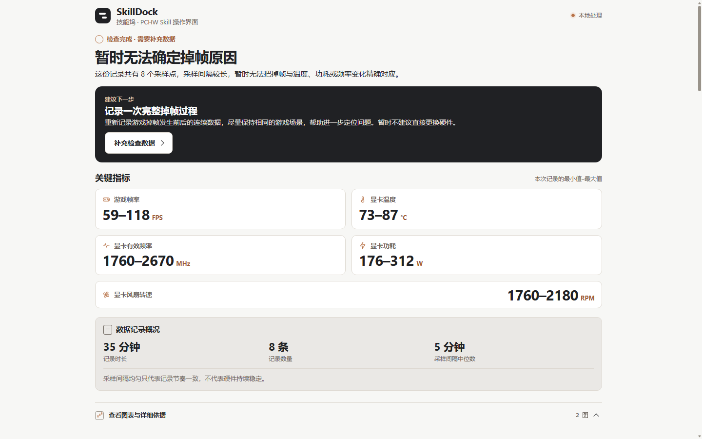

# PC Hardware Workbench

[中文](README.md) | [English](README.en.md)

**Windows 电脑诊断与安全调参 Agent Skill。** 在 Codex、DeepSeek Harness
或其他兼容 Agent 中读取本机硬件信息，分析 HWiNFO、PresentMon、日志和截图，
先整理证据与缺失项，再给出排查、调参或升级建议。所有硬件变更都由你手动完成。

当前版本为 **2.9.3 公开 Pre-release 测试版**（PCHW 资产标签
`2.9.3-test.2`）。目前没有正式稳定版。

[下载 PCHW Skill](https://github.com/Feng23-feng/pc-hardware-workbench/releases/download/v2.9.3-test.2/pc-hardware-workbench-v2.9.3-test.2-installer.zip) ·
[下载 SkillDock 面板包](https://github.com/Feng23-feng/pc-hardware-workbench/releases/download/v0.1.0-rc.7/SkillDock-PCHW-0.1.0-rc.7-win-x64-user.zip) ·
[下载 Portable](https://github.com/Feng23-feng/pc-hardware-workbench/releases/download/v2.9.3-test.2/pc-hardware-portable-v2.9.3-test.2.zip) ·
[项目展示](https://feng23-feng.github.io/pc-hardware-workbench/skill-evolution/)

  

## 能解决什么问题

- **检查当前配置。** 读取处理器、显卡、主板、内存、存储、显示器和电池等可见信息，
  并明确哪些字段无法读取，不猜缺失型号。
- **分析卡顿、掉帧和温度问题。** 读取 HWiNFO/PresentMon CSV、传感器快照和日志，
  保留时间窗口、采样间隔、缺失值与来源，输出可追溯的图表和判断依据。
- **降低盲目调参风险。** CPU/GPU 调参先检查设备、基线、固定负载、恢复路径和停止
  条件；信息不足时只给补证动作，不生成可直接套用的参数。
- **判断继续使用、维护还是升级。** 结合设备、场景、预算和现有证据比较方案，不用
  单个跑分替代硬件诊断。

PCHW 是一个 Agent Skill，不是独立聊天机器人。Agent 负责对话与推理；本机工具负责
只读采集、确定性分析和证据校验。需要图形面板时，再选择可选的 SkillDock。

## 选择安装方式

| 你的场景 | 选择 | 安装后得到 |
| --- | --- | --- |
| 在 Codex 或其他兼容 Agent 中聊天、采集和分析 | **PCHW Skill** | 完整 Skill、脚本、证据规则与本地分析能力，无面板 |
| 需要 Graphite Copper 2.0 图形操作面板 | **SkillDock + PCHW** | 当前 Codex 对话中的本地图形界面、附件、图表与结果同步；rc.7 用户包内嵌基于 `2.9.3-test.1` 的 PCHW 发布子集 |
| 不使用 Agent，或希望零安装运行 | **PCHW Portable** | 独立 Windows 菜单、采集、CSV/日志分析和证据工具 |

### 1. PCHW Skill

[下载 PCHW Skill 安装包](https://github.com/Feng23-feng/pc-hardware-workbench/releases/download/v2.9.3-test.2/pc-hardware-workbench-v2.9.3-test.2-installer.zip)

1. 校验并解压 `pc-hardware-workbench-v2.9.3-test.2-installer.zip`。
2. 双击 `Install-PC-Hardware-Workbench.cmd`。
3. 重启 Codex，或新建一个对话。
4. 调用 `$pc-hardware-workbench`。

这个包不包含 SkillDock、Node 或 DSH 专用适配文件。Codex 默认安装目录为
`%USERPROFILE%\.codex\skills\pc-hardware-workbench`。

### 2. SkillDock 面板包

[下载 SkillDock rc.7 用户包](https://github.com/Feng23-feng/pc-hardware-workbench/releases/download/v0.1.0-rc.7/SkillDock-PCHW-0.1.0-rc.7-win-x64-user.zip)

当前公开面板测试包是 **SkillDock `0.1.0-rc.7`**。其用户包内嵌的是基于
PCHW `2.9.3-test.1` 的 `2.9.3` 发布子集，并不包含最新的
`2.9.3-test.2`。它按 `pchw-source-hosted` contract `1.0`、UI schema `1.2`、
事件 schema `1.0` 和所需能力与 `2.9.3-test.2` 做兼容校验，但这两个渠道的
跨包组合尚未完成同一发行包级别的人工签收。

1. 已安装 Codex Desktop 的用户下载上面的 `win-x64-user.zip`。
2. 校验并解压后双击 `Install.cmd`。
3. 等待安装完成，再打开 Codex 当前用户对话。
4. 描述硬件问题；明确同意后，Skill 会打开当前任务对应的面板。

SkillDock 不是另一个 Agent，也不替代 Codex。面板只承诺当前 Codex 用户对话；DSH
和其他宿主继续使用无面板的 PCHW Skill。安装 rc.7 用户包时会备份并替换已有的
PCHW Skill；如果需要保留 `2.9.3-test.2`，应先安装独立的 `test.2` Skill，再在
高级选项中使用 Runtime-only，不运行整合用户包。

### 3. PCHW Portable

[下载 PCHW Portable](https://github.com/Feng23-feng/pc-hardware-workbench/releases/download/v2.9.3-test.2/pc-hardware-portable-v2.9.3-test.2.zip)

1. 校验并解压 `pc-hardware-portable-v2.9.3-test.2.zip`。
2. 双击 `开始使用.cmd`。
3. 从菜单选择配置读取、排障、遥测、PresentMon 或手动调校。

Portable 不需要 Codex、DSH、API key、安装程序或管理员权限，也不提供 Agent 对话和
SkillDock 面板。

## 一个脱敏的 GPU 掉帧案例

下面使用的是脱敏 GPU 掉帧记录。页面没有生成“硬件健康分”，而是先说明记录不足：
35 分钟只有 8 个采样点，采样间隔中位数为 5 分钟，无法把掉帧与温度、功耗或频率
变化精确对应。本次记录显示帧率 `59–118 FPS`、显卡温度 `73–87 °C`、有效频率
`1760–2670 MHz`、功耗 `176–312 W`。这些数值说明记录中发生了变化，但不能单独
证明掉帧原因。面板给出的下一步是记录故障前后的连续数据，并暂不建议直接更换硬件。
这就是 PCHW 的核心原则：**先说明证据能证明什么、不能证明什么，再给下一步。**

  <picture>
    <source media="(max-width: 700px)" srcset="docs/skill-evolution/assets/pchw-result-mobile.png">
    
  </picture>

## 权限与安全边界

  

- 不自动修改 BIOS/UEFI、频率、电压、功耗墙、风扇、内存时序或固件。
- 不自动提权、安装或启动监控软件，也不绕过权限、反作弊或厂商限制。
- 本地分析需要明确授权；“仅本次允许”只覆盖当前文件和当前检查。
- CSV 分析和 artifact 绑定来源哈希；跨文件复用和完整性不匹配会失败关闭。
- 出现焦味、火花、液体、熔化接头、鼓包电池或可见破损时，先停止设备和性能测试。
- GPU 调参必须有当前控制值、基线、固定负载、恢复路径和停止条件。

更多说明见 [隐私与安全边界](docs/privacy-and-safety.md)。

## 当前发布状态

- PCHW：[`2.9.3-test.2`](https://github.com/Feng23-feng/pc-hardware-workbench/releases/tag/v2.9.3-test.2)，
  公开 Pre-release；没有正式稳定版。
- SkillDock：[`v0.1.0-rc.7`](https://github.com/Feng23-feng/pc-hardware-workbench/releases/tag/v0.1.0-rc.7)，
  用户包内含基于 PCHW `2.9.3-test.1` 的 `2.9.3` 发布子集；没有更新版可引用。
- SkillDock rc.7 与 PCHW `2.9.3-test.2` 按契约兼容，但 Skill-only +
  Runtime-only 跨包组合仍为 PENDING，不等同于已完成同一发行包人工签收。
- 两个渠道使用独立版本线，不兼容的面板版本会安全拒绝加载。
- `BroadDistributionApproved: false`。
- `SKIP`：缺少已运行且明确授权的本地 LibreHardwareMonitor 环境时，Live LHM
  Web/WMI 读取跳过。
- `PENDING`：真实 Codex Thread 权限允许/拒绝与恢复、人工交互、干净 Windows
  安装升级修复卸载、多平台和最终发行字节的实际 Edge 验收。

这些状态不会被自动测试结果改写为 `PASS`，也不能据此宣称正式稳定版。

## 高级选项

以下入口保留现有能力，但不是大多数用户的第一步。

<strong>DSH、手动安装、Runtime-only、兼容矩阵与历史版本</strong>

### DeepSeek Harness

[下载 DSH 适配包](https://github.com/Feng23-feng/pc-hardware-workbench/releases/download/v2.9.3-test.2/pc-hardware-workbench-deepseek-harness-v2.9.3-test.2.zip)

包内含 PCHW 2.9.3 Skill 与 DSH 适配文件。DSH 支持配置、排障、采集和 CSV 分析，
但不提供本版 SkillDock 面板。

### 手动安装

[下载手动安装包](https://github.com/Feng23-feng/pc-hardware-workbench/releases/download/v2.9.3-test.2/pc-hardware-workbench-v2.9.3-test.2-manual.zip)

适合需要自行检查目录内容或已有安装脚本的高级用户。不要在同一宿主扫描目录中保留
多个包含 `SKILL.md` 的 PCHW 版本。

### SkillDock Runtime-only

[下载 SkillDock Runtime-only](https://github.com/Feng23-feng/pc-hardware-workbench/releases/download/v0.1.0-rc.7/SkillDock-Runtime-0.1.0-rc.7-win-x64.zip)

仅用于已经安装兼容 PCHW Skill、但缺少 SkillDock 应用和 Node 的情况。rc.7 对
PCHW `2.8.0` 提供 legacy 桥；后续版本必须声明兼容的
`surface_contracts["pchw-source-hosted"]`，满足最低版本与能力要求，并在 UI/事件
schema 不匹配时安全拒绝。它可用于保留现有 PCHW `2.9.3-test.2`、只补面板运行时的
高级组合，但该组合仍为 PENDING。

### 支持矩阵

| 宿主 | PCHW 聊天、采集、CSV | SkillDock 面板 |
| --- | --- | --- |
| Codex 当前用户对话 | 支持 | 支持 |
| DeepSeek Harness | 支持 | 不提供 |
| 其他 Agent 宿主 | 按宿主文件访问能力使用 | 不承诺 |

`v0.1.0-rc.5 + PCHW 2.9.0` 和 `v0.1.0-rc.4 + PCHW 2.8.0` 仅作为历史面板测试包
保留。安装、升级和故障处理见 [安装与升级](docs/installation.md)。

## 技术能力

<strong>确定性证据、显存口径、案卷、RAG 与本地证据 CLI</strong>

- `pcwb.ps1` 提供只读的固定 JSON envelope、结构化状态/退出码、输入与 artifact
  SHA-256，覆盖盘点、遥测、PresentMon、证据包、声明核验和 Doctor。
- HWiNFO 原始显存值默认保留；只有 GPU、原始工具、显示工具和版本匹配受控 profile
  时，显式深度图才派生 Afterburner 等效值，`provisional` profile 默认拒绝。
- 遥测分析保留采样跨度、缺失值、来源、时间窗口和分类状态统计；普通文本分析默认
  返回摘要，只有明确请求时才生成图表 artifact。
- 用户声明核验区分当前实测、用户确认、历史记录、估算、冲突和不可核验值。
- 多轮、多证据或包含参数变更的调试可以维护私有本地案卷；新对话可恢复紧凑摘要，
  但不会自动把旧值当成当前值。
- 本地 RAG 证据缓存、宿主支持的联网查证、已运行的本机 LibreHardwareMonitor、
  截图说明和跨轮案卷均按需使用。

## 反馈与文档

- [提交问题或使用反馈](https://github.com/Feng23-feng/pc-hardware-workbench/issues/new/choose)
- [安装与升级](docs/installation.md)
- [使用方式](docs/usage.md)
- [常见问题](docs/troubleshooting.md)
- [隐私与安全边界](docs/privacy-and-safety.md)
- [技术架构](docs/architecture.md)
- [English installation](docs/en/installation.md)
- [English privacy and safety](docs/en/privacy-and-safety.md)
- [变更记录](CHANGELOG.md)
- [GitHub Releases](https://github.com/Feng23-feng/pc-hardware-workbench/releases)
- [项目展示](https://feng23-feng.github.io/pc-hardware-workbench/skill-evolution/) ·
  [情景演示](https://feng23-feng.github.io/pc-hardware-workbench/skill-evolution/interactive/) ·
  [文件星球](https://feng23-feng.github.io/pc-hardware-workbench/skill-evolution/orrery/)

反馈时请先移除用户名、设备序列号、完整本地路径、API key 和其他个人信息。真实硬件
日志请优先提供时间窗口、采样间隔、设备型号和脱敏后的 CSV。

## 版本与许可

版本状态以 [GitHub Releases](https://github.com/Feng23-feng/pc-hardware-workbench/releases)
和 [CHANGELOG.md](CHANGELOG.md) 为准。`main` 分支可能领先于最近一个公开 Release。

源码使用 [MIT License](LICENSE)。Copyright (c) 2026 Feng23-feng.

第三方软件、安装器、图片和厂商资料遵循各自许可证；未经单独许可不得重新分发。
